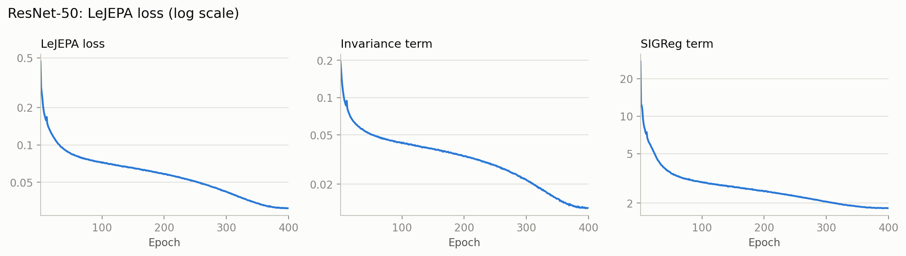
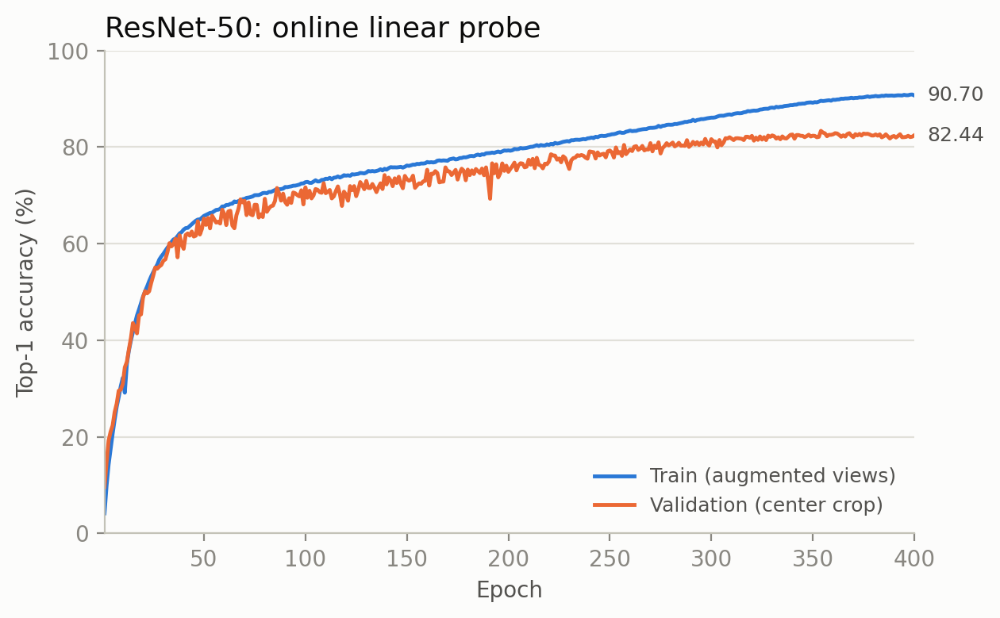
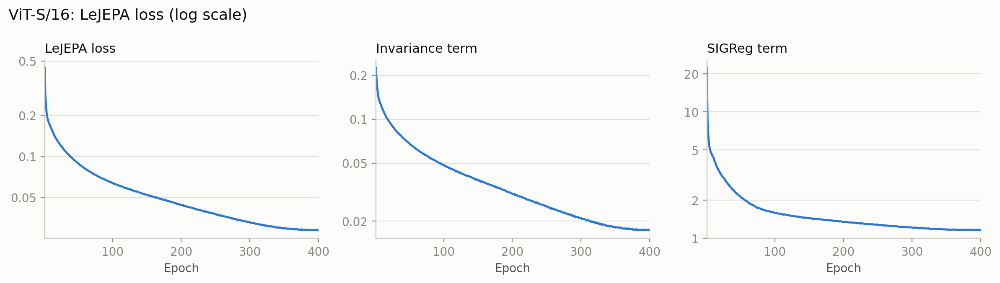
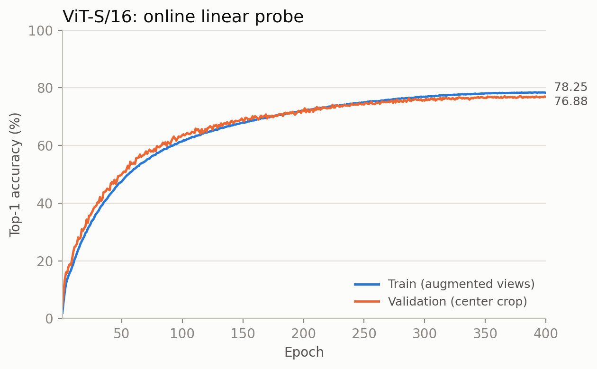
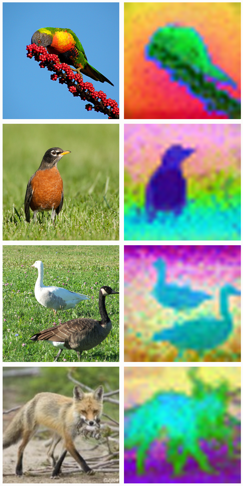

# LeJEPA on ImageNet-100

An unofficial, compact PyTorch implementation of [LeJEPA](https://arxiv.org/abs/2511.08544) pretraining on ImageNet-100 with **2 views per image**, for ResNet-50 and ViT-S/16, plus linear evaluation on ImageNet-100 and 12 transfer datasets. With ResNet-50 it reaches **83.38%** linear accuracy, matching the paper's 83.49% for the same setting (Table 7). The code is about 1,400 lines and a run fits on a single machine with 4 16-GB GPUs, so it is meant as a readable starting point for LeJEPA experiments at ImageNet-100 scale. Official implementation: [galilai-group/lejepa](https://github.com/galilai-group/lejepa).

## 1. Results

All models are pretrained for 400 epochs on ImageNet-100 with **2 views per image** and batch size 512.

### 1.1 ImageNet-100

| Backbone | Encoder params | Online probe | Linear (L-BFGS) | Paper | Pretraining time |
| --- | --- | --- | --- | --- | --- |
| ResNet-50 | 23.5M | 82.44 | **83.38** | 83.49 | 15.7 h |
| ViT-S/16 | 21.7M | 76.88 | **76.46** | — | 9.6 h |

The online probe is the final-epoch validation accuracy. The linear accuracy uses the frozen encoder (see [Linear evaluation](#4-linear-evaluation)). Pretraining times are on 4× RTX A4000 GPUs (see [Hardware](#3-hardware)). The paper reports no 2-view ViT result.

### 1.2 Transfer

Linear evaluation of the frozen ImageNet-100 encoders.

| Backbone | CIFAR-10 | CIFAR-100 | Food-101 | Pets\* | Flowers102\* | Caltech101\* | Cars | Aircraft\* | DTD | SUN397 | MIT67 | CUB-200 | **Average** |
| --- | --- | --- | --- | --- | --- | --- | --- | --- | --- | --- | --- | --- | --- |
| ResNet-50 | 85.75 | 63.35 | 59.27 | 75.34 | 84.82 | 84.24 | 41.21 | 43.02 | 69.10 | 49.98 | 64.25 | 36.77 | **63.09** |
| ViT-S/16 | 84.85 | 63.39 | 58.04 | 66.03 | 85.00 | 79.02 | 30.39 | 35.23 | 63.78 | 46.09 | 60.45 | 39.67 | **59.33** |

\* Mean per-class accuracy. All other datasets report top-1 accuracy.

### 1.3 Training curves

Per-epoch values from pretraining. The loss and the online probe's training accuracy are averaged over each epoch. The training accuracy is measured on the augmented training views, so it can sit below the validation accuracy, which is evaluated at the end of each epoch. The loss panels use a log scale.

#### 1.3.1 ResNet-50





#### 1.3.2 ViT-S/16





### 1.4 Feature visualization

Following LeJEPA's Figure 14, each map shows the ViT-S/16 last-block patch features of a selected ImageNet-100 validation image. Images are resized to $448\times448$ for a finer $28\times28$ patch grid; the model was trained at $224\times224$, so its position embeddings are interpolated. The features are projected onto their first 3 principal components, shown as RGB next to each image. PCA is fit separately for each image, so colors are only comparable within an image.



## 2. Training setup

### 2.1 Augmentations

Each image gets **2 views**. Each view is drawn independently from this pipeline, applied in this order:

| Step | Transform | Parameters | Probability |
| --- | --- | --- | --- |
| 1 | RandomResizedCrop | $224\times224$, scale $(0.2, 1.0)$, bilinear | 1 |
| 2 | Color jitter | brightness 0.4, contrast 0.4, saturation 0.2, hue 0.1 | 0.8 |
| 3 | Grayscale | — | 0.2 |
| 4 | Gaussian blur | $\sigma \in [0.1, 2.0]$ (PIL) | 0.5 |
| 5 | Solarization | threshold 128 | 0.2 |
| 6 | Horizontal flip | — | 0.5 |
| 7 | Normalize | ImageNet mean and std | 1 |

For the online probe, validation images are resized to 224 pixels on the shorter side and center-cropped to $224\times224$. The pipeline is defined in `im100_ssl_dataset` in `datasets_utils.py`.

### 2.2 Hyperparameters

LeJEPA is pretrained on ImageNet-100 (the CMC class subset).

| Setting | ResNet-50 | ViT-S/16 (`vit_small_patch16_224`) |
| --- | --- | --- |
| Views | 2 per image, $224\times224$ | 2 per image, $224\times224$ |
| Epochs | 400 | 400 |
| Batch size | 512 (128 per GPU on 4 GPUs) | 512 (128 per GPU on 4 GPUs) |
| Optimizer | AdamW, weight decay on all parameters | AdamW, weight decay on all parameters |
| Learning rate | $2\times10^{-3}$ | $5\times10^{-4}$ |
| Weight decay | $10^{-1}$ | $5\times10^{-2}$ |
| Schedule | 10-epoch linear warmup, then cosine decay to $1/1000$ of the learning rate | same |
| $\lambda$ | 0.01 | 0.01 |
| SIGReg | 1024 random projections, 17 integration points on $[0, 3]$ | same |
| Projector (`--proj_dim` sets the output) | Linear (2048 → 512), then MLP 512 → 2048 → 2048 → 512 with batch normalization and ReLU | Linear (384 → 512), then MLP 512 → 2048 → 2048 → 64 with batch normalization and ReLU |
| Encoder output | Globally average-pooled features (2048-d) | CLS token after the final LayerNorm (384-d) |
| Encoder normalization | Synchronized batch normalization | LayerNorm |
| Stochastic depth | — | Drop-path rate 0.1 |
| Precision | bf16 mixed precision | bf16 mixed precision |
| Online probe | LayerNorm and linear classifier on detached encoder features (does not affect the encoder) | same |

## 3. Hardware

All runs use a single machine:

| Component | Details |
| --- | --- |
| GPUs | 4× NVIDIA RTX A4000, 16 GB each, connected over PCIe (no NVLink) |
| CPU | 2× AMD EPYC 9354, 32 cores each |
| RAM | 755 GB |
| Software | PyTorch 2.7.1 with CUDA 12.8, NVIDIA driver 570 |
| Training | DDP across the 4 GPUs, bf16 mixed precision, 6 data-loading workers per GPU |

Pretraining time on this machine (each epoch includes the online-probe validation):

| Backbone | Time per epoch | 400 epochs | GPU-hours |
| --- | --- | --- | --- |
| ResNet-50 | 2.4 min | 15.7 h | 63 |
| ViT-S/16 | 1.4 min | 9.6 h | 38 |

## 4. Linear evaluation

We freeze the pretrained encoder and train only a linear classifier on its features, for ImageNet-100 and each of the 12 transfer datasets. Images are resized and center-cropped to $224\times224$ without augmentation, and features are extracted once: the pooled output for ResNet-50, and the concatenated CLS tokens of the last two blocks for ViT (as in LeJEPA). CUB-200 follows CASSLE instead: images are resized to 256, and each training and validation image contributes ten $224\times224$ crops. A logistic-regression classifier is fit on these features with L-BFGS. Its L2 penalty is chosen from 45 log-spaced values between $10^{-6}$ and $10^{5}$ by accuracy on a validation split. The classifier is then refit on the training and validation splits together and evaluated once on the test set. We report top-1 accuracy, except mean per-class accuracy for Pets, Flowers102, Caltech101 and Aircraft. This is the protocol of [Kornblith et al. (2019)](https://arxiv.org/abs/1805.08974), as used by [AugSelf](https://arxiv.org/abs/2111.09613) and [CASSLE](https://arxiv.org/abs/2306.06082).

## 5. Getting started

### 5.1 Installation

Use Python 3.11 and install the pinned versions:

```bash
pip install -r requirements.txt --extra-index-url https://download.pytorch.org/whl/cu128
```

### 5.2 Data

- **ImageNet-100.** The 100 ImageNet classes listed in `splits/imagenet100.txt` (the [CMC subset](https://github.com/HobbitLong/CMC/blob/master/imagenet100.txt)). Arrange them as ImageFolder directories:
  - `train/`: the training images of those classes.
  - `val/`: the official ImageNet validation images of those classes.
- **Transfer datasets.** Nothing is downloaded during evaluation, so all 12 datasets must be on disk first. Put each one in its own folder under `datasets_folder` (set in `scripts/run_linear.sh`) with the contents below. The fixed splits for Caltech101, SUN397 and CUB-200 are in `splits/`.

| Dataset | Folder | Source | Expected contents |
| --- | --- | --- | --- |
| CIFAR-10 | `CIFAR10` | torchvision, `download=True` | `cifar-10-batches-py/` |
| CIFAR-100 | `CIFAR100` | torchvision, `download=True` | `cifar-100-python/` |
| Food-101 | `Food-101` | torchvision, `download=True` | `food-101/` |
| Pets | `oxford_pets` | [oxford_pets.zip](https://huggingface.co/zhengli97/prompt_learning_dataset/blob/main/oxford_pets.zip) | `oxford-iiit-pet/{images, annotations}` |
| Flowers102 | `oxford_flowers` | [oxford_flowers.zip](https://huggingface.co/zhengli97/prompt_learning_dataset/blob/main/oxford_flowers.zip) and [setid.mat](https://huggingface.co/datasets/cnak47/cv-datasets/resolve/main/setid.mat) | `flowers-102/{jpg, imagelabels.mat, setid.mat}` |
| Caltech101 | `caltech-101` | [caltech-101.zip](https://huggingface.co/zhengli97/prompt_learning_dataset/blob/main/caltech-101.zip) | `caltech101/101_ObjectCategories/` |
| Stanford Cars | `stanford_cars` | [stanford_cars.zip](https://huggingface.co/zhengli97/prompt_learning_dataset/blob/main/stanford_cars.zip) | `cars_train/`, `cars_test/`, `devkit/`, `cars_test_annos_withlabels.mat` |
| Aircraft | `fgvc_aircraft` | [fgvc_aircraft.zip](https://huggingface.co/zhengli97/prompt_learning_dataset/blob/main/fgvc_aircraft.zip) | `fgvc-aircraft-2013b/data/` |
| DTD | `dtd` | [dtd.zip](https://huggingface.co/zhengli97/prompt_learning_dataset/blob/main/dtd.zip) | `dtd/dtd/{images, labels}` |
| SUN397 | `sun397` | [sun397.zip](https://huggingface.co/zhengli97/prompt_learning_dataset/blob/main/sun397.zip) | `SUN397/`, `Training_01.txt`, `Testing_01.txt` |
| MIT67 | `MIT67` | [images](https://huggingface.co/datasets/zhangyun04/VLM-UB/tree/main/mit_indoor67), [TrainImages.txt](https://web.mit.edu/torralba/www/TrainImages.txt) and [TestImages.txt](https://web.mit.edu/torralba/www/TestImages.txt) | `Images/`, `TrainImages.txt`, `TestImages.txt` |
| CUB-200 | `CUB_200_2011` | [CUB-200-2011](https://data.caltech.edu/records/65de6-vp158) | `images/`, `images.txt`, `train_test_split.txt` |

For the three torchvision datasets, download each once into its folder, for example:

```bash
python -c "from torchvision.datasets import CIFAR10; CIFAR10('/path/to/datasets/CIFAR10', download=True)"
python -c "from torchvision.datasets import CIFAR100; CIFAR100('/path/to/datasets/CIFAR100', download=True)"
python -c "from torchvision.datasets import Food101; Food101('/path/to/datasets/Food-101', download=True)"
```

### 5.3 Pretraining

Set `data_path` in the script, then run one of:

```bash
bash scripts/run_pretrain_LeJEPA_resnet50.sh
bash scripts/run_pretrain_LeJEPA_vitsmall.sh
```

Each script sets every `pretrain.py` argument as a variable at its top. Outputs go to `results/LeJEPA_<model>_V2/`:
- `model_epoch_<e>.pth` every 50 epochs and at the end, holding the `encoder`, `projector` and `sigreg` weights. `<e>` counts from 0, so the final checkpoint is `model_epoch_399.pth`.
- `log.log` and `args.json`.
- TensorBoard logs in `logs/`.

### 5.4 Linear evaluation

Set `vision_model` and `datasets_folder` in the script, then run:

```bash
bash scripts/run_linear.sh
```

It evaluates `model_epoch_399.pth` on ImageNet-100 and the 12 transfer datasets. Each result is in `results/linear/LeJEPA_<model>_V2/<dataset>/<dataset>_lbfgs/log.log`; its `Report:` line gives the accuracy.

## 6. Repository layout

| Path | Contents |
| --- | --- |
| `pretrain.py` | LeJEPA pretraining with an online linear probe |
| `jepa_models.py` | LeJEPA model: projector and loss |
| `sigreg.py` | SIGReg regularizer |
| `datasets_utils.py` | Pretraining augmentations and linear-evaluation datasets |
| `transfer_linear.py` | L-BFGS linear evaluation of a frozen encoder |
| `utils.py` | Logging helpers |
| `splits/` | ImageNet-100 class list and fixed transfer splits |
| `scripts/` | Pretraining and linear-evaluation scripts |
| `figures/` | Figures shown in this README |
| `requirements.txt` | Pinned package versions |

## 7. Differences from the LeJEPA paper

- **Views.** We use 2 global $224\times224$ views and no local crops. The paper's default is 8 views: 2 global views plus 6 local views at $96\times96$. Its ResNet-50 sweep on ImageNet-100 (Table 7) includes 2 views, which is the setting we match.
- **No weight averaging.** We use no SWA or teacher network. The paper lists SWA as optional and shows that it helps ViTs (Table 4).
- **ViT backbone.** We use ViT-S/16. The paper's ImageNet-100 ViT is ViT-S/8.
- **ViT projector output.** We use 64 dimensions for ViT-S/16. The paper found 64 better than 512 for ViT-L (Table 1).

## 8. Acknowledgments and citation

This code follows the official [LeJEPA implementation](https://github.com/galilai-group/lejepa). The linear-evaluation protocol and transfer splits follow [AugSelf](https://arxiv.org/abs/2111.09613) and [CASSLE](https://arxiv.org/abs/2306.06082), which build on [Kornblith et al. (2019)](https://arxiv.org/abs/1805.08974).

If you use this code, please cite LeJEPA:

```bibtex
@misc{balestriero2025lejepaprovablescalableselfsupervised,
      title={LeJEPA: Provable and Scalable Self-Supervised Learning Without the Heuristics},
      author={Randall Balestriero and Yann LeCun},
      year={2025},
      eprint={2511.08544},
      archivePrefix={arXiv},
      primaryClass={cs.LG},
      url={https://arxiv.org/abs/2511.08544},
}
```

## 9. AI assistance disclosure

Parts of the code, the analysis of the training runs and this README were written with the help of Claude (Anthropic). All experiments were run by the author, and every reported number comes from those runs' logs.

## 10. License

This code is released under [CC BY-NC 4.0](LICENSE), the same license as the official [LeJEPA implementation](https://github.com/galilai-group/lejepa); `sigreg.py` is adapted from it.
